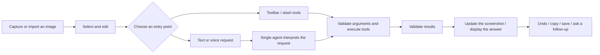

<p align="center">
  <br />
  
  <br /><br />
</p>

<h1 align="center">SnapMind</h1>

<p align="center"><a href="README.md">简体中文</a> · English</p>

<p align="center">
  <strong>Capture, annotate, extract text, and translate in place. Use natural language and an AI companion to turn what you see into useful information.</strong>
</p>

<p align="center">
  <a href="#quick-start"></a>
  
  <a href="#agent-and-memory"></a>
  <a href="#project-structure"></a>
  <br />
  
  
  
  
</p>

<p align="center">
  <a href="#features">Features</a> ·
  <a href="#quick-start">Quick start</a> ·
  <a href="#agent-and-memory">Agent and memory</a> ·
  <a href="#development-and-validation">Development and validation</a>
</p>

---

SnapMind is an AI screenshot tool for Windows. After capturing or importing an image, you can draw on it, extract text, translate it, or ask the AI to “highlight this line,” “remove this text,” or “turn this into a table.” The application converts your request into tool calls and applies the results to the current screenshot.


From the selected region to the conversation panel, SnapMind keeps capture and follow-up work in one workflow. The features below follow the sequence: capture, understand, edit, and continue the conversation.

## Highlights

- **Keep working after capture.** Annotate, extract text, translate, and ask questions about the same image without switching between separate tools.
- **Call tools with natural language.** A single agent interprets requests, validates arguments, and executes tools, supporting multiple steps and follow-up questions.
- **Keep translations in place.** OCR line boxes locate translated text while preserving columns and relative positions. Switch to the original, select text, or copy translations.
- **Separate removal from masking.** Content removal repairs the background; pixelation and blur obscure content. Each has its own tool.
- **Undo your edits.** The active capture window supports undo, redo, and layer operations. AI edits finish with a concise confirmation.
- **Find tools easily.** Common actions appear in the toolbar. Type `/` in the conversation to search for additional image tools.
- **Continue previous conversations.** History retains questions, answers, and screenshots so you can reopen a conversation with its context.
- **Configure models independently.** LLM, OCR, ASR, and TTS have separate configurations, model lists, connection tests, and local usage statistics.

## How It Works



## Features

### Capture and Annotate

Use a shortcut to capture a region, or import an existing image for editing. Combine rectangles, circles, arrows, freehand drawing, text, numbered labels, highlighting, and the eyedropper. Adjust colors, sizes, and styles as needed.

Annotations can be selected, moved, resized, or deleted, with undo and redo available. Other actions include pixelation, blur, clearing annotations, copying, and saving. The desktop application also provides scrolling capture, pinned images, and long-image editing.


Use these tools to point out issues, highlight key information, prepare feedback, or mask sensitive areas.

### Text Extraction: Turn Images into Usable Text

Click the text extraction button, or ask “Extract all text from this screenshot and preserve line breaks.” You can review, edit, and copy the result for notes, quotations, or further questions.

For example, select a webpage's key points and ask “Extract all text from this screenshot, preserving the original line breaks and indentation.” The text appears directly in the conversation.


### In-Place Translation: Read Without Losing the Layout

In-place translation locates text lines and places translations in the corresponding regions. Choose a target language, switch between the original and translated text, copy all translations, or translate again.

This example translates SlideCraft's English highlights into Simplified Chinese through a natural-language request. OCR accuracy, translation length, and complex backgrounds affect the layout. Some English fragments remain in the example, so review the result before use.


### Content Removal: Erase and Repair the Background

Paint over the area you want to remove, and the application repairs the background. You can also identify text in the conversation and let the tool locate it before removal.

Removal and pixelation serve different purposes: removal attempts to repair the background, while pixelation obscures the content. Repaired textures may differ from the original background; inspect the result and use undo when needed.

### Natural-Language Actions: Tell the AI What to Do

Open AI Chat from the capture toolbar and enter your request. The agent interprets it, selects tools, validates arguments, and executes the operation. Completion feedback appears after the edits have been applied to the screenshot.

```text
Highlight the line that says “Ask a different question.”
Remove the text from this screenshot and repair the background; do not pixelate it.
Crop out the title.
Undo the last operation.
```

Coordinate-based actions require a reliable location source. If a text target is ambiguous or arguments are incomplete, the application may request clarification or retry. Undo snapshots from an active window are not restored when reopening a historical conversation.

### Voice Companion: Talk While Viewing Your Screenshot

Click the voice call button in the capture toolbar to display the AI companion beside the selected region. Reply cards and call controls keep the conversation close to the image.


- **Voice messages:** Recordings appear as voice bars with playback, pause, and expandable transcripts.
- **Companion calls:** Spoken requests use the same agent and tool workflow as text requests.
- **Independent microphone controls:** Pause incoming speech separately from AI audio playback.
- **Reply cards:** AI replies appear above the companion, with height adapting to the content. User transcripts remain available to backend conversation records.
- **Voice history:** Completed exchanges can be saved as separate text conversations with screenshots and call start/end markers, then continued through text.
- **Models and voices:** Configure ASR and TTS separately, and fetch or select TTS voices.

Behavior depends on device permissions, model configuration, network conditions, and background noise.

### Table Extraction: Structure Image Content

The table tool recognizes rows and columns in screenshots and displays structured results. Copy them to Excel or use CSV and Markdown formats.

The table extraction view preserves column names and row content for further organization or export.

### Slash Tools: Discover and Call Capabilities

Type `/` in the conversation to browse, search, and select image tools. Add instructions after selecting a tool. Tools that require source text or coordinates display the corresponding argument fields.

<details>
<summary>View the slash tool catalog</summary>


</details>

| Category | Capabilities |
| --- | --- |
| Recognition and extraction | Text, local OCR, tables, QR codes/barcodes, links, and email addresses |
| Image editing | Crop, highlight, pixelate, blur, remove content, extract transparent layers, and add image regions |
| Understanding and annotation | Screenshot explanations, AI annotations, object detection, code explanations, paper annotations, answer checking, and formula extraction |
| Conversation and organization | Image conversations, image notes, and multiple image references |

Some capabilities are available through natural-language conversations. Consult the live tool catalog for current entry points and arguments. Desktop actions such as saving, copying, and pinning images use their respective interface buttons.

## Agent and Memory

### Conversation History: Continue with Your Screenshots

History retains user questions, AI answers, and referenced screenshots. Search, rename, pin, delete, or manage conversations in batches. Reopen a conversation to review its image and previous exchanges, then continue asking questions.

The history list supports pinned conversations, date groups, and search. Opening an entry lets you continue discussing its screenshot.


SnapMind uses one agent to call multiple tools. The harness enforces tool allowlists, argument schemas, location-source checks, result validation, bounded retries, and cancellation. Failures are not displayed as successful operations.

Clear single-step tasks finish directly after the tool succeeds and its result passes validation, avoiding redundant planning and summarization. Requests with multiple requirements continue through the remaining steps.

| Type | Purpose and limits |
| --- | --- |
| Short-term memory | Each request includes conversation context. Longer history is compacted within a budget while recent exchanges and original records are retained. |
| Long-term memory | Relevant preferences are retrieved across conversations. Background extraction defaults to approximately six hours of inactivity; it does not immediately memorize every exchange. |
| Images and editing state | Original images are retained, with operations applied to working images and layers. Undo snapshots belong to the active window; reopening history does not restore the full undo stack. |

Long-term memory requires traceable evidence from user messages and filters credentials and temporary states. See [AGENT_ARCHITECTURE.md](AGENT_ARCHITECTURE.md) for execution constraints and memory policies.

## Quick Start

### Requirements

Windows, Node.js 22.12 or later, Python 3.11 or later, and Rust stable. Desktop development also requires Microsoft C++ Build Tools and the WebView2 Runtime. Native screen capture, Windows OCR, and some desktop interactions are implemented only on Windows.

### Install Dependencies

Download or clone the repository, then open PowerShell in its root directory:

```powershell
python -m venv .venv
.\.venv\Scripts\python.exe -m pip install -r backend\requirements.txt
npm.cmd ci
```

### Launch the Application

```powershell
npm.cmd run dev:desktop
```

This starts the Python backend on port `8776`, Vite on port `5174`, and the Tauri desktop application. Configure your model services in Settings, then press `Alt+Z` to capture or import an image to begin.

### Build an Executable

```powershell
npm.cmd run build:exe
```

Output is written to `src-tauri/target/release/`. This command builds an executable rather than an installer and should not be treated as a verified standalone backend packaging solution.

## Configuration and Everyday Use

### Model Configuration: Choose Services Independently

Configure LLM, OCR, ASR, and TTS separately. Save multiple configurations, select an active model, fetch the provider's model list, and test connections. ASR/TTS lists are filtered by purpose; TTS also offers voice selection.

You provide your own model services and API keys. When using a cloud service, relevant images, text, or audio are sent to that provider. Local configuration storage does not mean all AI processing happens on your device.

<details>
<summary>View model configuration</summary>


</details>

### Usage Statistics: Track Requests and Tokens

Settings provides LLM and OCR usage statistics, with date ranges, refresh, and export. LLM statistics distinguish input, output, and cache-hit tokens, with overall and per-model trends.

Request counts, token distribution, and usage trends help you understand how your models are being used.

<details>
<summary>View usage statistics</summary>


</details>

### Shortcuts, Appearance, and the Feature Guide

The default capture shortcut is `Alt+Z` and can be customized. Drawing and editing tools have their own shortcuts. Screenshot actions are suppressed while typing text, chatting, or recording shortcuts to avoid accidental activation. The interface supports theme and language switching.

<details>
<summary>View shortcut and appearance settings</summary>


</details>

| Action | Default shortcut |
| --- | --- |
| Start capture | `Alt+Z` |
| Rectangle / circle / arrow / pen | `R` / `O` / `A` / `P` |
| Text / highlight / content removal | `T` / `H` / `W` |
| Pixelation / blur / eyedropper | `M` / `B` / `I` |
| Text extraction / translation / AI Chat | `L` / `F` / `C` |
| Undo / redo | `Ctrl+Z` / `Ctrl+Y` |
| Delete a selected annotation | `Backspace` |
| Save / finish and copy / cancel | `S` / `Enter` / `Esc` |

Use the feature guide in Settings to search for a button's purpose and usage instructions.

<details>
<summary>View the feature guide</summary>


</details>

## Project Structure

```text
.
├── frontend/              Vue / TypeScript interface and assets
├── backend/
│   ├── app/               FastAPI, image tools, speech, and storage
│   │   └── agent/         ReAct workflow, schemas, harness, and state
│   └── tests/             Backend automated tests
├── src-tauri/             Rust / Windows desktop host
├── scripts/               Launch, validation, and performance scripts
├── docs/
│   └── images/readme/     Feature screenshots
└── .snapmind/             Runtime configuration, conversations, memory, and cache
```

The source distribution includes only documentation and a configuration example under `.snapmind`. The application creates local runtime data on first launch. Keys, history, databases, caches, `artifacts`, and build outputs are excluded by `.gitignore`. Documentation images are stored separately under `docs/images/readme/`.

## Development and Validation

```powershell
npm.cmd run typecheck
npm.cmd run build:web
.\.venv\Scripts\python.exe -m pytest backend\tests
cargo test --manifest-path src-tauri\Cargo.toml
```

UI validation scripts use Playwright and Edge. Some native scripts require a desktop debugging environment, and `live` scripts access configured model services. Read scripts before running them and avoid submitting private desktop content, conversations, or credentials.

## Documentation and Resources

- [Agent architecture and memory policies](AGENT_ARCHITECTURE.md)
- [Image tools and API interfaces](docs/image-tools.md)
- [Feature image index](docs/README_SCREENSHOTS.md)
- [Source export and privacy exclusions](EXPORT_NOTES.md)

The overview follows the highlights, workflow, features, installation, and validation structure of the [SlideCraft README](https://github.com/qingfengrumeng/SlideCraft/blob/main/README.en.md). Font and model-icon sources and licenses are retained in their asset directories.

Issues and pull requests are welcome. Include reproduction steps, your environment, and screenshots with sensitive content removed. Do not submit API keys or private conversation data.
