<p align="center">
  <br />
  
  <br /><br />
</p>

<h1 align="center">SnapMind</h1>

<p align="center">简体中文 · <a href="README.en.md">English</a></p>

<p align="center">
  <strong>截图、标注、识字与原位翻译，用自然语言和 AI 精灵接着处理，让看见的内容变成可用的信息。</strong>
</p>

<p align="center">
  <a href="#快速开始"></a>
  
  <a href="#agent-与记忆"></a>
  <a href="#项目结构"></a>
  <br />
  
  
  
  
</p>

<p align="center">
  <a href="#功能展示">功能展示</a> ·
  <a href="#快速开始">快速开始</a> ·
  <a href="#agent-与记忆">Agent 与记忆</a> ·
  <a href="#开发与验证">开发与验证</a>
</p>

---

SnapMind 是一款面向 Windows 的 AI 截图工具。截取或导入图片后，可以直接绘图、提取文字、翻译，也可以告诉 AI：“高亮这一行”“把这些文字涂抹掉”“整理成表格”。软件将需求转换为工具调用，并把实际处理结果应用到当前截图。

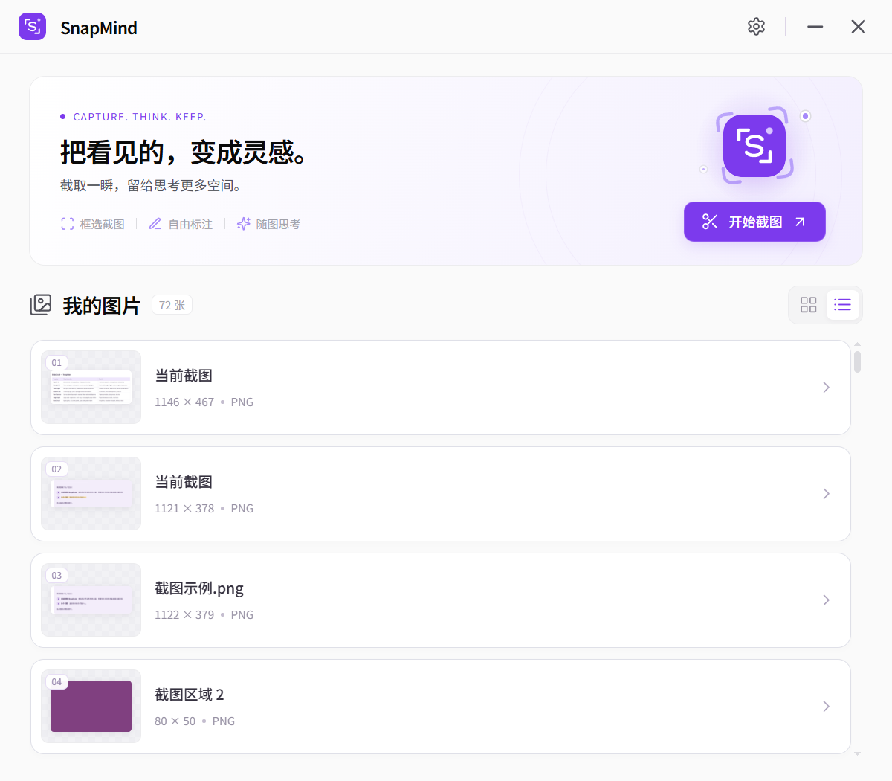

从左侧选区到右侧对话，SnapMind 把截图和后续处理放在同一个工作流里。下面按“截取 → 理解 → 编辑 → 继续讨论”的顺序介绍功能，每个场景搭配一张界面图。

## 特色

- **截图之后，继续处理。** 截图、标注、识字、翻译和问答围绕同一张图片展开，减少在不同工具之间切换。
- **自然语言调用工具。** 单 Agent 分析需求、校验参数并执行工具，支持分步操作和基于上一轮结果继续提问。
- **译文留在原位置。** 通过真实 OCR 行框定位译文，保留分栏和相对位置，可切换原文、选择文字、复制译文。
- **涂抹与打码分开。** 内容消除用于修补背景；马赛克、模糊用于遮挡内容，各有独立工具。
- **编辑可以回退。** 活动截图窗口支持撤销、重做和图层操作；AI 编辑完成后提供简短反馈。
- **工具入口明确。** 常用操作放在工具栏，其余图片工具可在对话中输入 `/` 搜索和调用。
- **会话可以延续。** 历史记录保留问题、回答与截图；重新打开后，可以带着原来的上下文继续讨论。
- **模型独立配置。** LLM、OCR、ASR、TTS 分开配置，提供模型列表、连接测试和本地用量统计。

## 工作流程

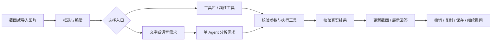

## 功能展示

### 截图与手工标注

按快捷键开始区域截图，或导入已有图片进行编辑。矩形、圆形、箭头、画笔、文字、序号、荧光笔和取色等工具可以搭配使用，并可调整颜色、大小和样式。

标注支持选中、移动、缩放与删除；不满意时可以撤销或重做。还提供马赛克、模糊、清空标注、复制与保存。桌面端具有滚动截图、贴图及长图编辑入口。

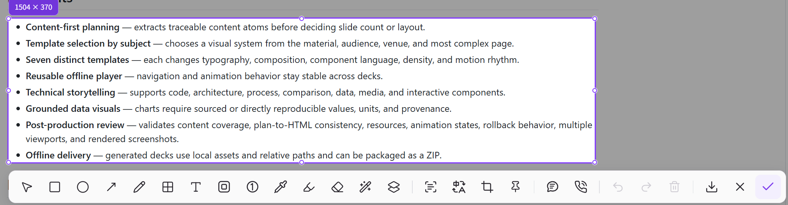

适合圈出问题、标记重点、制作反馈截图和对敏感区域打码。

### 文字提取：图片变成可用文本

点击工具栏的文字提取按钮，或提问“提取截图里的全部文字，保留换行”。识别结果可以查看、编辑和复制，用于整理资料、摘录内容或继续问答。

例如，框选网页中的要点后，输入“提取这张截图中的全部文字，保留原文的换行和缩进”，识别结果会直接出现在对话里。

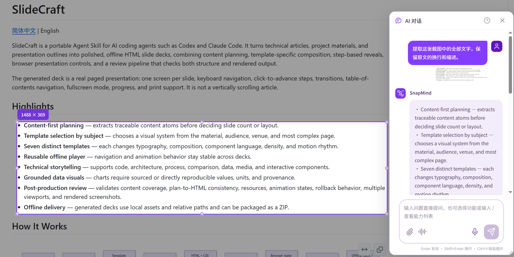

### 原位翻译：保留位置，直接阅读

原位翻译先定位图片中的文字行，再把译文放回对应区域。支持选择目标语言、切换原文与译文、复制全部译文和重新翻译。

本例通过自然语言把 SlideCraft 的英文要点翻译为简体中文，并在原位置显示译文。识别准确性、译文长度和复杂背景会影响排版；图中仍有少量英文片段，建议检查后再使用。

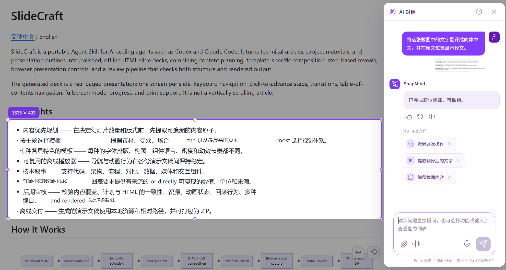

### 涂抹消除：移除内容，修补背景

用涂抹画刷覆盖需要移除的区域，软件会执行背景修补。也可以在对话中指出要消除的文字，让工具根据识别位置处理。

涂抹消除和马赛克是两个不同操作：前者尝试移除内容并修补背景，后者遮挡内容。修补后的纹理可能与原背景不同，建议检查效果；当前窗口支持撤销。

### 自然语言操作：告诉 AI 要做什么

从截图工具栏打开 AI 对话，输入任务即可。Agent 会分析需求、选择工具、校验参数并执行；编辑结果应用到截图后，再显示完成反馈。

```text
请高亮截图中“换个问题”这一行。
将截图中的文字涂抹掉，修补背景，不要打马赛克。
把标题裁剪出来。
撤销刚才的操作。
```

坐标类操作需要可靠的位置来源；文字目标不唯一或参数不完整时，系统可能要求补充信息或重试。活动窗口的撤销快照不会在重新打开历史会话时恢复。

### 语音精灵：看着截图，自然交流

点击截图工具栏的语音通话按钮，AI 精灵会在选区旁出现。回复信息卡与通话控制围绕精灵展示，便于一边看截图，一边交流。

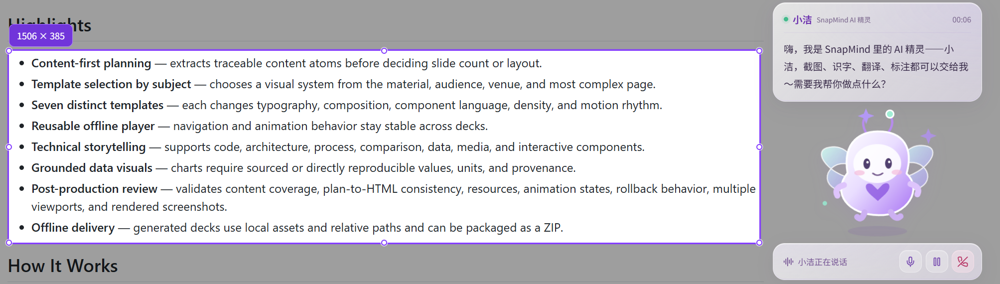

- **语音消息：** 录音后以语音条显示，支持播放、暂停及展开识别文字。
- **AI 精灵通话：** 从截图进入语音交互，语音问题进入同一套 Agent 与工具流程。
- **独立麦克风控制：** 可以暂停接收用户语音，与暂停 AI 播放分别控制。
- **回复信息卡：** 精灵上方展示 AI 回复，卡片高度随内容调整；用户语音文字仍用于后端会话记录。
- **语音历史：** 有效问答可保存为含截图的独立文字会话，标记通话开始和结束，方便后续文字问答。
- **模型与音色：** ASR、TTS 分别配置，TTS 提供获取音色列表和音色选择。

实际效果取决于设备权限、模型配置、网络和环境噪声。

### 表格提取：把图片内容结构化

使用表格工具识别截图中的行列，结果可展示为结构化表格，支持复制到 Excel，也支持 CSV、Markdown 等复制形式。

下面展示模板表格的提取效果，支持保留列名和行内容，方便继续整理或导出。

### 斜杠工具：发现与明确调用能力

在对话输入框输入 `/`，查看、搜索和选择图片工具。选中后可以补充要求；需要指定原文或坐标时，会展示对应参数输入项。

<details>
<summary>查看斜杠工具目录</summary>

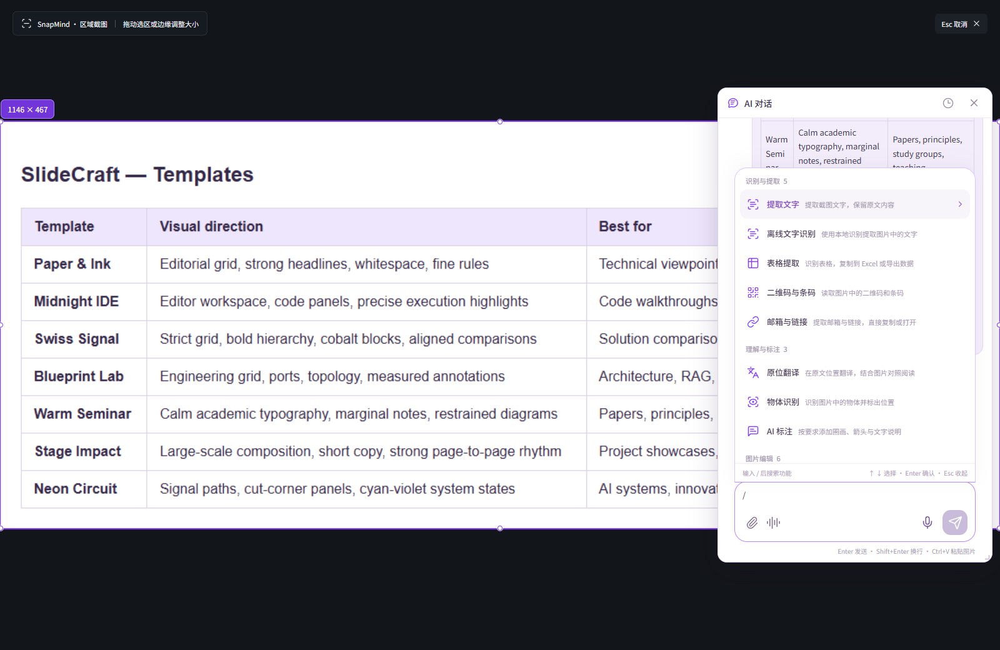

</details>

| 类别 | 能力 |
| --- | --- |
| 识别与提取 | 文字、本地 OCR、表格、二维码／条码、链接与邮箱 |
| 图片编辑 | 裁剪、高亮、马赛克、模糊、内容消除、透明图层提取、增加图片区域 |
| 理解与标注 | 截图解释、AI 标注、物体识别、代码理解、论文注释、作答检查、公式提取 |
| 对话与整理 | 连续图片问答、图片笔记、多张图片引用 |

部分能力通过自然语言对话提供；具体入口和参数以软件中的实时工具列表为准。保存、复制、贴图等桌面生命周期操作仍使用对应按钮。

## Agent 与记忆

### 历史会话：带着截图继续讨论

会话记录保留用户问题、AI 回答和引用截图，支持搜索、重命名、置顶、删除与批量操作。重新打开会话后，可以查看截图和先前内容，继续文字问答。

历史列表支持置顶、按日期分组和会话检索。打开其中一个会话后，可以继续围绕原截图问答。

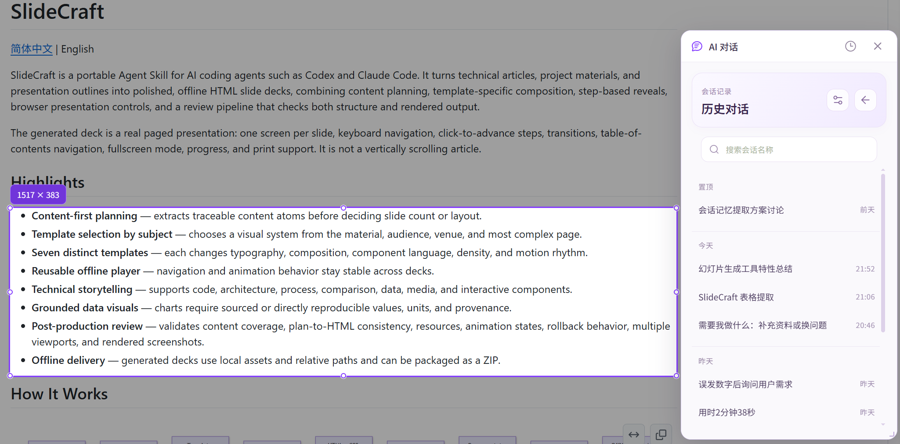

SnapMind 使用一个 Agent 调用多种工具。Harness 负责工具白名单、参数 Schema、位置来源检查、结果校验、有限重试和取消控制；失败不会被当作成功展示。

明确的单步任务在工具成功并通过校验后直接反馈，减少重复规划与总结；复合需求仍继续执行后续步骤。

| 类型 | 作用与边界 |
| --- | --- |
| 短期记忆 | 每次请求带入会话上下文；较长历史按预算压缩，保留最近对话与原始记录 |
| 长期记忆 | 按相关性检索跨会话偏好；默认在会话闲置约 6 小时后后台提取，并非立即记住所有对话 |
| 截图与编辑状态 | 保留原图，处理应用到工作图片和图层；撤销快照属于活动窗口，历史重开不恢复完整撤销栈 |

长期记忆要求可追溯的用户原文证据，过滤凭据及暂时状态。更多执行约束与记忆策略见 [AGENT_ARCHITECTURE.md](AGENT_ARCHITECTURE.md)。

## 快速开始

### 环境要求

Windows、Node.js 22.12 或更新版本、Python 3.11 或更新版本、Rust stable。桌面开发还需要 Microsoft C++ Build Tools 和 WebView2 Runtime。系统截图、Windows OCR 和部分桌面交互仅在 Windows 上实现。

### 安装依赖

下载或克隆仓库，在项目根目录打开 PowerShell：

```powershell
python -m venv .venv
.\.venv\Scripts\python.exe -m pip install -r backend\requirements.txt
npm.cmd ci
```

### 启动软件

```powershell
npm.cmd run dev:desktop
```

启动命令会运行 Python 后端（`8776`）、Vite（`5174`）和 Tauri 桌面程序。随后在设置中配置模型服务，按 `Alt+Z` 截图，或导入图片开始处理。

### 构建可执行文件

```powershell
npm.cmd run build:exe
```

输出目录为 `src-tauri/target/release/`。当前命令生成可执行文件，不生成安装包；它不应被当作已验证的独立后端打包方案。

## 配置与日常使用

### 模型配置：分别选择所需服务

LLM、OCR、ASR、TTS 各自配置。可以保存多个配置、选择当前使用的模型、获取服务端模型列表并测试连接。ASR/TTS 的列表按用途过滤，TTS 另提供音色选择。

模型服务和 API Key 由使用者自行提供。调用云端服务时，相关图片、文字或音频会发送到对应提供方。本地保存配置并不意味着所有 AI 运算都在设备上完成。

<details>
<summary>查看模型配置界面</summary>

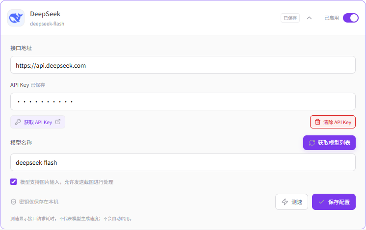

</details>

### 使用统计：看得见的请求与 Token

设置页提供 LLM 和 OCR 用量统计，支持时间范围选择、刷新和导出。LLM 统计区分输入、输出及缓存命中 Token，并展示总体及模型维度的趋势。

通过请求次数、Token 分布和使用趋势，可以了解模型的使用情况。

<details>
<summary>查看用量统计界面</summary>

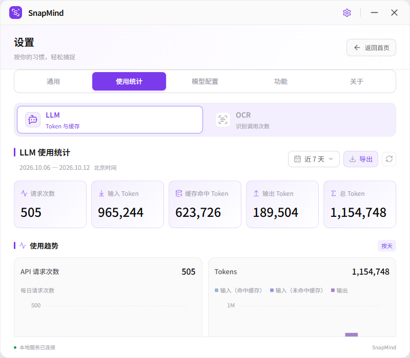

</details>

### 快捷键、外观与功能指南

开始截图的默认快捷键为 `Alt+Z`，可自定义。绘图和编辑工具也有独立快捷键；输入文字、对话或录制快捷键时，避免误触截图操作。界面支持主题和语言切换。

<details>
<summary>查看快捷键与外观设置</summary>

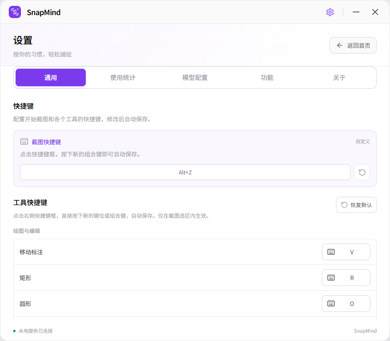

</details>

| 操作 | 默认快捷键 |
| --- | --- |
| 开始截图 | `Alt+Z` |
| 矩形 / 圆形 / 箭头 / 画笔 | `R` / `O` / `A` / `P` |
| 文字 / 荧光笔 / 涂抹消除 | `T` / `H` / `W` |
| 马赛克 / 模糊 / 取色 | `M` / `B` / `I` |
| 文字提取 / 翻译 / AI 对话 | `L` / `F` / `C` |
| 撤销 / 重做 | `Ctrl+Z` / `Ctrl+Y` |
| 删除所选标注 | `Backspace` |
| 保存 / 完成并复制 / 取消 | `S` / `Enter` / `Esc` |

不知道某个按钮怎么用时，可以查看设置中的功能指南，按名称搜索说明和使用方法。

<details>
<summary>查看功能指南</summary>

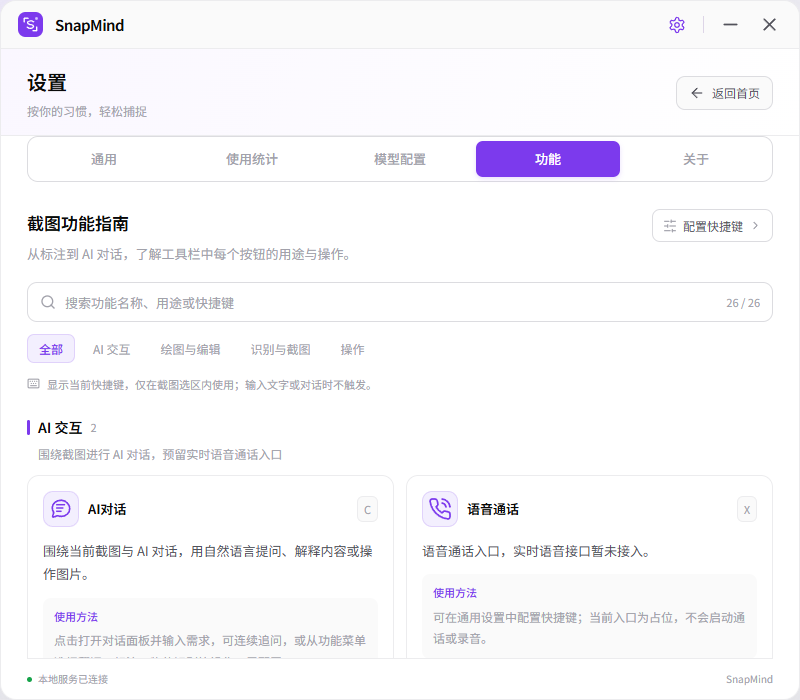

</details>

## 项目结构

```text
.
├── frontend/              Vue / TypeScript 界面与资源
├── backend/
│   ├── app/               FastAPI、图像工具、语音与存储
│   │   └── agent/         ReAct 工作流、Schema、Harness、状态
│   └── tests/             后端自动化测试
├── src-tauri/             Rust / Windows 桌面宿主
├── scripts/               启动、验证与性能检查
├── docs/
│   └── images/readme/     本页功能截图
└── .snapmind/             运行时配置、会话、记忆与缓存
```

上传源码中，`.snapmind` 仅保留说明与配置示例。首次运行会在本机创建真实数据；密钥、历史、数据库、缓存、`artifacts` 和构建产物已由 `.gitignore` 排除。本页经过检查的说明截图单独存放在 `docs/images/readme/`，用于公开文档展示。

## 开发与验证

```powershell
npm.cmd run typecheck
npm.cmd run build:web
.\.venv\Scripts\python.exe -m pytest backend\tests
cargo test --manifest-path src-tauri\Cargo.toml
```

UI 验证脚本使用 Playwright 和 Edge。部分原生脚本需要桌面调试环境，`live` 脚本会访问已配置模型；执行前请阅读脚本，避免提交真实桌面、私人会话或凭据。

## 文档与资源

- [Agent 架构与记忆策略](AGENT_ARCHITECTURE.md)
- [图片工具与调用接口](docs/image-tools.md)
- [功能图片索引](docs/README_SCREENSHOTS.md)
- [GitHub 源码副本与隐私排除说明](EXPORT_NOTES.md)

本介绍页参考 [SlideCraft README](https://github.com/qingfengrumeng/SlideCraft/blob/main/README.en.md) 的特色、流程、功能、安装与验证结构。字体及模型图标的来源和许可保留在各资源目录内。

欢迎通过 Issue 提交问题或通过 Pull Request 改进功能。反馈时建议附上复现步骤、运行环境及脱敏截图，避免提交 API Key 或私人会话数据。
